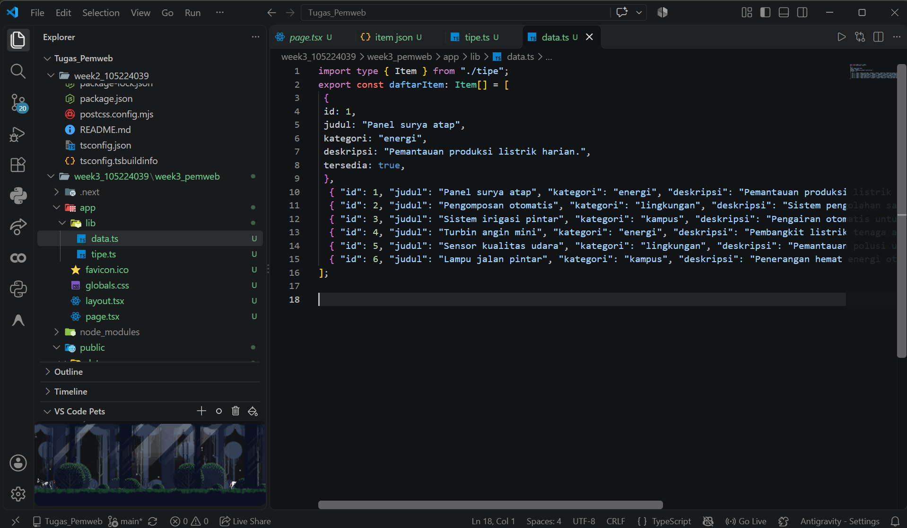
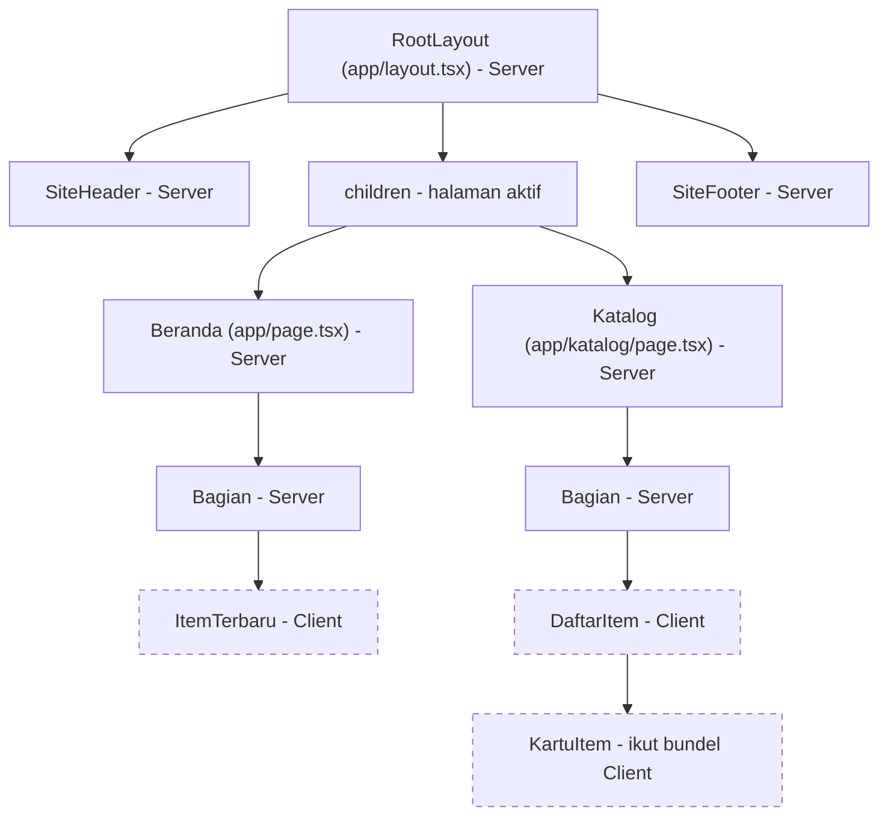
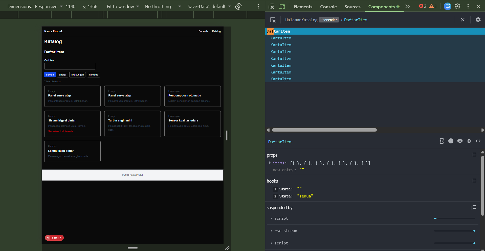
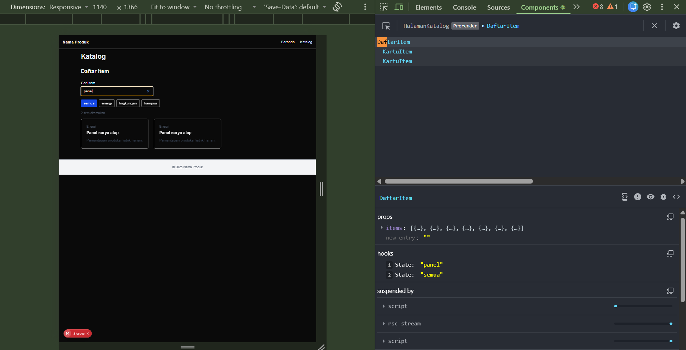
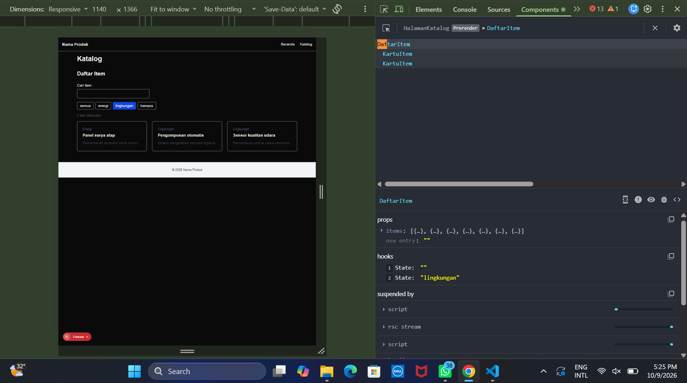
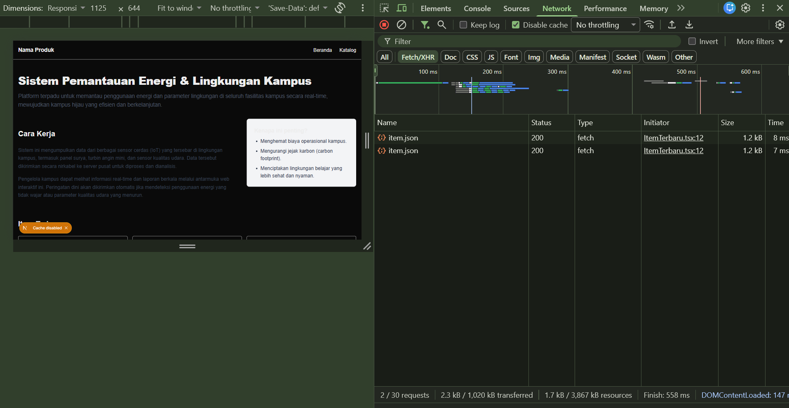
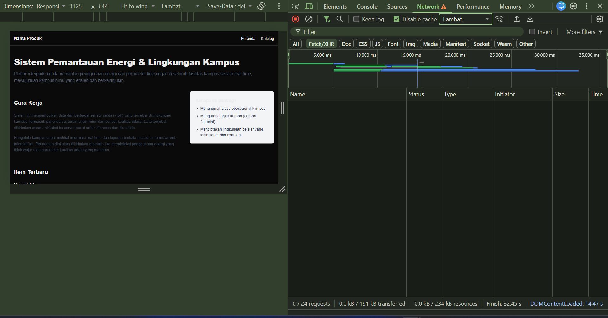
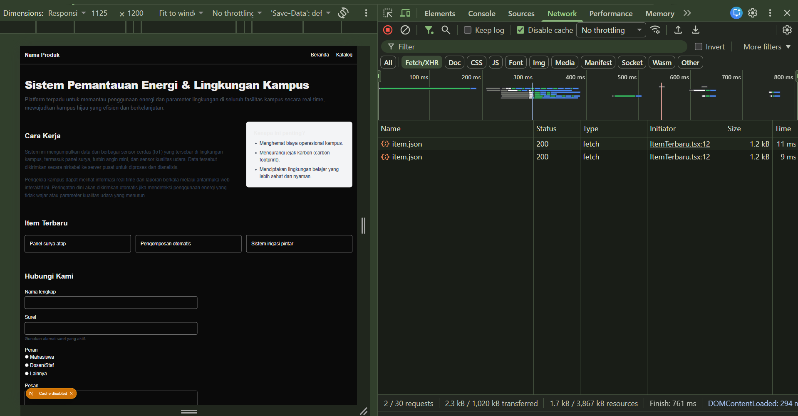
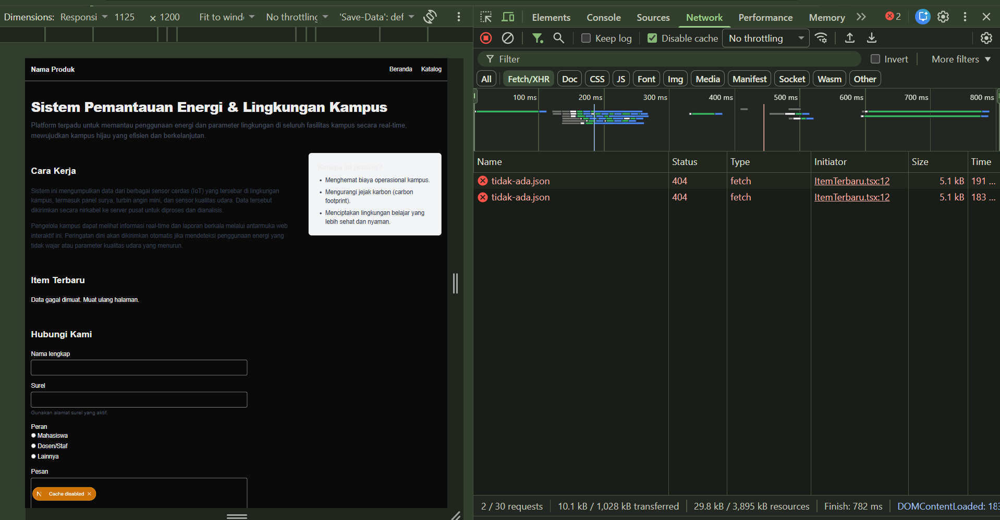
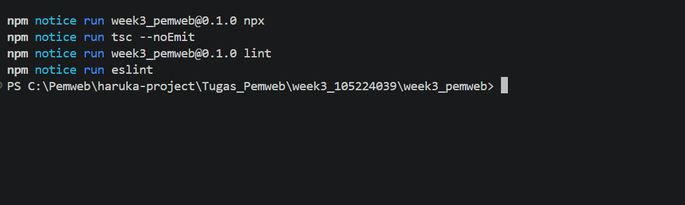

docs/praktikum/modul-03.md
# Dokumen Teknis Modul 3 — TypeScript dan Komponen React
Nama/NIM : 105224039
Repositori : https://github.com/putu-cpu/PemWeb_week3_105224039
## 1. Tipe Data Produk
- Isi lib/tipe.ts dan alasan pemilihan union type serta properti opsional

```ts
export type Kategori = "energi" | "lingkungan" | "kampus";
 
export interface Item {
  id: number;
  judul: string;
  kategori: Kategori;
  deskripsi: string;
  tersedia: boolean;
  gambar?: string;
}
```
Data tiruan pada `lib/data.ts` berisi enam item bertipe `Item[]` (`id` 1 sampai 6) yang mencakup ketiga kategori: Panel surya atap (energi), Pengomposan otomatis (lingkungan), Sistem irigasi pintar (kampus), Turbin angin mini (energi), Sensor kualitas udara (lingkungan), dan Lampu jalan pintar (kampus).

**Alasan pemilihan union type (`Kategori`).** Kategori item hanya terbatas pada tiga pilihan yang sah. Dengan union dari literal type, nilai di luar pilihan (misalnya `"transportasi"`) langsung ditolak pemeriksa tipe saat kode ditulis, sebelum aplikasi dijalankan. Hal ini diuji dengan mengubah sementara kategori satu item menjadi `"transportasi"`, lalu menjalankan `npx tsc --noEmit`:



### Rincian tipe
 
| Properti | Tipe | Wajib? | Alasan |
|---|---|---|---|
| `id` | `number` | Wajib | Pengenal unik tiap item. Dipakai sebagai `key` saat daftar ditampilkan dengan `map`, sehingga harus unik dan stabil. |
| `judul` | `string` | Wajib | Nama item. Dipakai pada kartu dan sebagai bahan pencarian (`item.judul.toLowerCase().includes(...)`). |
| `kategori` | `Kategori` | Wajib | Dibatasi ke tiga pilihan lewat union type, dipakai untuk filter dan label pada kartu. |
| `deskripsi` | `string` | Wajib | Penjelasan singkat item yang ditampilkan pada kartu. |
| `tersedia` | `boolean` | Wajib | Penanda ketersediaan. Item yang `false` menampilkan keterangan "Sementara tidak tersedia" (conditional rendering). |
| `gambar` | `string` (opsional) | Opsional | Alamat gambar item. Tidak semua item memiliki gambar. |

Data tiruan pada `lib/data.ts` dideklarasikan sebagai `Item[]` dan berisi enam item (`id` 1 sampai 6) yang mencakup ketiga kategori: Panel surya atap (energi), Pengomposan otomatis (lingkungan), Sistem irigasi pintar (kampus), Turbin angin mini (energi), Sensor kualitas udara (lingkungan), dan Lampu jalan pintar (kampus). Karena larik diberi tipe `Item[]`, setiap objek di dalamnya diperiksa: properti wajib yang hilang, salah nama properti, atau salah tipe nilai langsung dilaporkan.

### Alasan pemilihan union type (`Kategori`)
 
Kategori item hanya terbatas pada tiga pilihan yang sah, yaitu `"energi"`, `"lingkungan"`, dan `"kampus"`. Jika `kategori` bertipe `string` biasa, salah ketik seperti `"enrgi"` lolos tanpa peringatan dan baru terlihat sebagai item yang "hilang" saat filter dipakai. Dengan union dari literal type:
 
- **Nilai di luar pilihan ditolak sebelum aplikasi dijalankan.** Kesalahan ditemukan saat kode ditulis (garis bawah merah di editor) dan oleh `npx tsc --noEmit`, bukan oleh pengguna.
- **Editor memberi saran nilai yang sah** (autocomplete) saat mengisi `kategori`.
- **Tipe lain dapat diturunkan dari `Kategori`.** Pada `DaftarItem`, `type Filter = Kategori | "semua"` menambah satu pilihan tanpa menulis ulang ketiga nilainya. Pada `KartuItem`, `Record<Kategori, string>` mewajibkan setiap kategori punya label; jika kategori baru ditambahkan ke `Kategori`, pemeriksa tipe langsung melaporkan label yang belum ada.
Hal ini diuji dengan mengubah sementara kategori satu item pada `lib/data.ts` menjadi `"transportasi"`, lalu menjalankan `npx tsc --noEmit`:


Galat tersebut menunjukkan bahwa `"transportasi"` tidak dapat ditetapkan pada tipe `Kategori`.

### Alasan properti opsional (`gambar?`)
 
Tidak semua item memiliki gambar. Dengan `gambar?: string`, properti ini boleh tidak ada pada data, sehingga item tanpa gambar tetap sah tanpa perlu nilai pengganti seperti `""`. Konsekuensinya, nilai `item.gambar` bertipe `string | undefined`. Kode yang memakainya wajib menangani kemungkinan `undefined` (misalnya `{item.gambar && }` dengan `alt` yang bermakna, atau gambar pengganti), dan pemeriksa tipe akan menolak kode yang mengabaikannya. Properti yang selalu ada pada setiap item (`id`, `judul`, `kategori`, `deskripsi`, `tersedia`) sengaja dibuat wajib agar komponen tidak perlu memeriksa keberadaannya.
 
### Alasan `interface` untuk `Item` dan `type` untuk union
 
| Konstruksi | Dipakai untuk | Contoh pada proyek |
|---|---|---|
| `interface` | Bentuk objek: entitas data dan props komponen | `Item`, `SiteHeaderProps`, `BagianProps` |
| `type` | Union dan bentuk data sederhana | `Kategori`, `Filter`, `Status`, `Tautan` |
 
Type alias dan interface sama-sama dapat mendefinisikan bentuk objek. Pembagian di atas mengikuti ketentuan modul dan dipakai konsisten di seluruh proyek. `interface` juga dapat diperluas dengan `extends` bila kelak diperlukan entitas turunan, sedangkan union hanya dapat dinyatakan dengan `type`.
 
Perlu dicatat bahwa tipe TypeScript hanya ada saat kode ditulis dan dikompilasi. Setelah dikompilasi menjadi JavaScript, tipe tidak diperiksa lagi saat aplikasi berjalan. Karena itu data yang dimuat lewat `fetch` (`item.json`) hanya diberi tipe `Item[]` sebagai pernyataan tipe dan belum divalidasi isinya; validasi saat berjalan dibahas pada Modul 5.
 
---

## 2. Struktur Komponen

### Diagram pohon komponen akhir
Node bergaris putus-putus adalah Client Component.
 

### Tabel komponen
 
| Komponen | Jenis | Props dan tipenya | Digunakan di |
|---|---|---|---|
| `SiteHeader` | Server | `namaProduk: string`, `tautan: Tautan[]` | `app/layout.tsx` (tampil di semua halaman) |
| `SiteFooter` | Server | `namaProduk: string` | `app/layout.tsx` (tampil di semua halaman) |
| `Bagian` | Server | `id: string`, `judul: string`, `children: React.ReactNode` | `app/page.tsx` (termasuk section "Cara Kerja" dan "Item Terbaru"), `app/katalog/page.tsx` |
| `KartuItem` | Server, tetapi ikut menjadi bagian Client Component karena diimpor oleh `DaftarItem` | `item: Item` | `DaftarItem` (satu kartu per item hasil filter) |
| `DaftarItem` | Client (`"use client"`) | `items: Item[]` | `app/katalog/page.tsx` |
| `ItemTerbaru` | Client (`"use client"`) | tanpa props | `app/page.tsx` di dalam `Bagian` |

### Alasan pemecahan komponen
 
- **Menghindari duplikasi.** Header dan footer dipindah ke `app/layout.tsx` sehingga cukup ditulis sekali dan otomatis tampil di setiap halaman.
- **Pola berulang dijadikan satu komponen.** Pola `<section>` + `<h2>` sebelumnya ditulis berulang di halaman utama (Modul 2). Sekarang dibungkus `Bagian` yang menerima `children`, dan dipakai lebih dari satu kali. `Bagian` juga menjaga aksesibilitas: `aria-labelledby` selalu menunjuk ke `<h2>` miliknya.
- **Satu kartu, banyak data.** `KartuItem` menerima satu `Item` lewat props, sehingga tampilan kartu sama di mana pun dipakai, hanya datanya yang berbeda.
- **Props bertipe.** Setiap komponen punya tipe props sendiri, jadi salah nama props atau salah tipe data langsung terdeteksi oleh TypeScript. Pada `KartuItem`, `Record<Kategori, string>` memastikan setiap kategori punya label; jika kategori baru ditambahkan di `lib/tipe.ts`, pemeriksa tipe melaporkan label yang belum ada.

### Alasan penempatan `"use client"`
 
Pada Next.js App Router, komponen secara bawaan adalah Server Component. Hook seperti `useState` dan `useEffect` serta event handler hanya bisa dipakai di Client Component. Karena komponen yang diimpor oleh Client Component ikut menjadi bagian dari Client Component, direktif `"use client"` saya letakkan sedalam mungkin pada pohon komponen, hanya pada bagian yang benar-benar butuh interaksi:
 
- `DaftarItem` memakai `useState` (kata kunci dan filter) dan event `onChange`/`onClick`, sehingga harus Client Component.
- `ItemTerbaru` memakai `useState` dan `useEffect` untuk memuat data dengan Fetch API, sehingga harus Client Component.
- Layout, header, footer, `Bagian`, dan kedua halaman tidak butuh state atau event, sehingga tetap Server Component dan kode JavaScript-nya tidak dikirim ke peramban.
- `app/katalog/page.tsx` (`HalamanKatalog`) sengaja tetap Server Component yang hanya meneruskan data tiruan ke `DaftarItem` lewat props. Pada tab Components, `DaftarItem` tampil sebagai anak dari `HalamanKatalog` yang berlabel *Prerender*, sesuai pembagian ini.
---

## 3. State dan Interaksi
### Tangkapan layar tab Components
 
Pada tab Components, komponen `DaftarItem` memiliki props `items` (larik objek `Item`) dan dua state pada bagian hooks. Hook 1 adalah `kataKunci` dan hook 2 adalah `filter`.
 
**Kondisi awal:** `kataKunci` berisi `""` dan `filter` berisi `"semua"`.



**Setelah mengetik "panel" di kolom cari:** state pertama berubah menjadi `"panel"`, dan daftar kartu hanya menampilkan item yang judulnya memuat kata itu.



**Setelah memilih filter "lingkungan":** state kedua berubah menjadi `"lingkungan"`, dan tombol "lingkungan" tampil aktif (biru).



| Hook | State | Tipe | Nilai awal | Fungsi |
|---|---|---|---|---|
| 1 | `kataKunci` | `string` | `""` | isi kolom pencarian |
| 2 | `filter` | `Filter` (`Kategori \| "semua"`) | `"semua"` | kategori yang sedang dipilih |

### Alur dari event hingga render ulang
 
1. Pengguna mengetik di kolom cari atau menekan tombol filter.
2. Event `onChange` (kolom cari) atau `onClick` (tombol filter) menjalankan fungsi pengubah state, yaitu `setKataKunci(e.target.value)` atau `setFilter(k)`.
3. Pemanggilan fungsi pengubah state menjadwalkan render ulang `DaftarItem` dengan nilai state terbaru.
4. Pada render ulang, `hasil` dihitung lagi dari props `items` dan state `kataKunci` serta `filter` memakai `items.filter(...)`. `hasil` adalah nilai turunan, jadi tidak disimpan sebagai state sendiri.
5. React menampilkan `hasil.map(...)` sebagai daftar `KartuItem`. Jika `hasil` kosong, tampil pesan "Tidak ada item yang sesuai."
6. Teks "N item ditemukan" (dengan `aria-live="polite"`) ikut berubah dan dibacakan pembaca layar tanpa memindahkan fokus.
Beberapa keputusan teknis pada komponen ini:
 
- **Controlled input.** `value={kataKunci}` dan `onChange` membuat nilai kolom selalu berasal dari state.
- **`key={item.id}`** dipakai pada daftar karena `id` unik dan stabil, tidak berubah walau urutan hasil berubah akibat penyaringan. Indeks larik kurang tepat karena posisi elemen bergeser saat daftar disaring. Syaratnya `id` harus benar-benar unik di data (lihat bagian 6).
- **`aria-pressed`** pada tombol filter memberi tahu pembaca layar tombol mana yang sedang aktif.
- **Conditional rendering** memakai ternary untuk memilih antara pesan kosong dan daftar, dan `&&` dengan kondisi boolean (`!item.tersedia &&`) pada `KartuItem`, misalnya untuk menampilkan "Sementara tidak tersedia" pada item yang `tersedia`-nya `false`.
---

## 4. Pengambilan Data
Data tiruan disalin ke `public/data/item.json` (larik objek dengan properti yang sama seperti `Item`) dan dimuat oleh Client Component `ItemTerbaru` melalui `fetch("/data/item.json")` di dalam `useEffect`. Pola ini dipilih agar permintaan terlihat pada panel Network.

### Tangkapan layar panel Network



Pada panel Network (filter Fetch/XHR), permintaan `item.json` berstatus **200** dengan tipe **fetch**, ukuran sekitar 1,2 kB (isi data JSON), dan *initiator* `ItemTerbaru.tsx:12`, yaitu baris `fetch("/data/item.json")` pada komponen `ItemTerbaru`. Hal ini membuktikan bahwa data dimuat dari berkas JSON melalui Fetch API, bukan diimpor langsung. Permintaan tampil dua kali karena pada mode pengembangan React Strict Mode menjalankan efek dua kali untuk menguji fungsi pembersih; variabel `dibatalkan` memastikan hanya hasil dari efek yang masih aktif yang mengubah state.
 
### Hasil pengujian tiga kondisi
 
| Kondisi | Cara pengujian | Hasil yang diharapkan | Bukti |
|---|---|---|---|
| Memuat | DevTools, Network, throttling "Slow 4G", muat ulang halaman | Teks "Memuat data…" tampil sebelum data datang | |
| Berhasil | Kondisi normal | Tiga item terbaru tampil di halaman utama |   |
| Gagal | Alamat diubah sementara menjadi `/data/tidak-ada.json` (server mengembalikan 404) | Pesan "Data gagal dimuat. Muat ulang halaman." tampil dengan `role="alert"` | |
 
Alamat sudah dikembalikan ke `/data/item.json` setelah pengujian.
 
### Penjelasan penanganan
 
- `fetch()` hanya menolak (reject) saat terjadi kegagalan jaringan. Respons 404 atau 500 tetap diterima sebagai respons biasa. Karena itu `res.ok` diperiksa lebih dulu, dan jika `false` dilempar `Error` agar masuk ke `catch` dan status menjadi `"gagal"`.
- Tiga kondisi dimodelkan dengan state `status` bertipe union `"memuat" | "berhasil" | "gagal"`, sehingga tidak ada nilai status di luar tiga pilihan itu.
- Variabel `dibatalkan` dan fungsi pembersih (cleanup) pada `useEffect` mencegah state diperbarui setelah komponen tidak lagi tampil. Larik dependensi `[]` membuat efek hanya berjalan sekali setelah komponen pertama kali tampil.
- `res.json()` bertipe `Item[]` hanya berupa pernyataan tipe (type assertion) dan tidak memvalidasi isi data saat aplikasi berjalan. Validasi data dibahas pada Modul 5.
---
Pada panel Network (filter Fetch/XHR), permintaan `item.json` berstatus **200** dengan tipe **fetch**, ukuran sekitar 1,2 kB (isi data JSON), dan *initiator* `ItemTerbaru.tsx:12`, yaitu baris `fetch("/data/item.json")` pada komponen `ItemTerbaru`. Hal ini membuktikan bahwa data dimuat dari berkas JSON melalui Fetch API, bukan diimpor langsung. Permintaan tampil dua kali karena pada mode pengembangan React Strict Mode menjalankan efek dua kali untuk menguji fungsi pembersih; variabel `dibatalkan` memastikan hanya hasil dari efek yang masih aktif yang mengubah state.
 
## 5. Verifikasi

### Keluaran npx tsc --noEmit dan npm run lint

Perintah dijalankan dari folder proyek `week3_pemweb` (terminal VS Code, PowerShell).
 
```
npx tsc --noEmit
```
 
Keluaran:
 
```
npm notice run week3_pemweb@0.1.0 npx
npm notice run tsc --noEmit
(tidak ada pesan galat; perintah selesai dan prompt kembali)
```
 
```
npm run lint
```
 
Keluaran:
 
```
npm notice run week3_pemweb@0.1.0 lint
npm notice run eslint
(tidak ada galat maupun peringatan; perintah selesai dan prompt kembali)
```


Kesimpulan: `npx tsc --noEmit` selesai tanpa galat tipe dan `npm run lint` selesai tanpa galat maupun peringatan, sehingga Checkpoint 5 pada bagian pemeriksaan tipe dan linter terpenuhi. Sebelumnya `lint` sempat memberi satu peringatan (`'Link' is defined but never used` pada `app/page.tsx`) yang sudah diperbaiki (lihat bagian 6).
 
---

## 6. Kendala dan Penyelesaian

| Kendala | Penyebab | Penyelesaian |
|---|---|---|
| Jumlah hasil dan kartu pada katalog tidak sesuai. Item "Panel surya atap" tampil dua kali, dan kartu tidak ikut berubah dengan benar saat filter dipilih. Hitungan galat di DevTools terus bertambah. | Data pada `lib/data.ts` memuat dua item dengan `id: 1` (item contoh dari modul tertinggal di samping enam item yang saya tulis). `id` yang sama dipakai sebagai `key`, sehingga React tidak bisa membedakan elemen. | Menghapus item contoh yang tertinggal sehingga `id` 1 sampai 6 unik, lalu memeriksa ulang `public/data/item.json` agar tidak mengandung duplikat. [ISI: tulis kondisi setelah diperbaiki, misalnya jumlah item dan galat menjadi 0] |
| `npx tsc --noEmit` tidak menampilkan hasil pemeriksaan tipe, melainkan membuka shell baru (`Entering npm script environment ... Type 'exit' or ^D when finished`). | Perintah terpotong menjadi dua baris (`npx` dan `tsc --noEmit` terpisah) dan dijalankan dari folder induk, bukan dari folder proyek `week3_pemweb`. | Menutup shell dengan `exit`, pindah ke folder proyek (`cd .\week3_105224039\week3_pemweb`), lalu menjalankan `npx tsc --noEmit` dalam satu baris. |
| Permintaan `item.json` mengembalikan 404 dan halaman menampilkan "Data gagal dimuat", padahal kode `ItemTerbaru` sama dengan modul. | Berkas data tersimpan dengan nama `item json` (spasi, tanpa titik), sehingga alamat `/data/item.json` tidak ditemukan server. | Memeriksa isi `public\data` dengan `dir`, lalu mengganti nama berkas menjadi `item.json` dengan `Rename-Item`. Setelah itu permintaan berstatus 200 dan tiga item tampil. |
| `npm run lint` memberi peringatan `'Link' is defined but never used` pada `app/page.tsx`. | Navigasi sudah dipindah ke `SiteHeader`, sehingga impor `Link` di halaman utama tidak terpakai lagi. | Menghapus baris `import Link from "next/link"` dari `app/page.tsx`, lalu menjalankan ulang `npm run lint` hingga bersih. |
| `npx tsc --noEmit` melaporkan 11 galat `TS2307: Cannot find module '@/lib/tipe'` pada banyak berkas, padahal kode tidak diubah. | Perintah dijalankan dari folder induk (`haruka-project`), sehingga `tsc` memakai konfigurasi dan alias `@/` yang berbeda dari proyek `week3_pemweb`. | Pindah ke folder proyek (`cd ...\week3_pemweb`) sebelum menjalankan `npx tsc --noEmit` dan `npm run lint`. |
| Peringatan Next.js: "ignored package-lock.json in ... because it is outside the current Git repository". | Ada `package-lock.json` di folder induk di luar repositori Git, sehingga Turbopack menebak akar proyek yang berbeda. | [ISI: tulis yang kamu lakukan, misalnya menambahkan `turbopack.root` pada `next.config.ts` atau mengabaikannya karena tidak memengaruhi hasil] |
 
---

## 7. Catatan Pemanfaatan AI

- **Alat:** Claude (Anthropic), melalui claude.ai.
- **Perintah utama:** meminta penjelasan cara menyusun Dokumen Teknis Modul 3, meminta draf kerangka `modul-03.md`, dan meminta pemeriksaan screenshot hasil kerja (editor, terminal, React DevTools).
- **Bagian yang digunakan:** draf kerangka dan kalimat penjelasan Dokumen Teknis, format tabel komponen dan diagram Mermaid, serta temuan dua masalah: `id` dobel pada `lib/data.ts` dan perintah `tsc` yang tidak benar-benar berjalan. [SESUAIKAN: tambahkan jika AI juga dipakai untuk menulis atau memperbaiki kode proyek, dan sebutkan bagiannya]
- **Cara memverifikasi:** seluruh isi dokumen saya cocokkan dengan kode di repositori; kedua masalah di atas saya periksa sendiri pada `data.ts` dan hasil di katalog lalu saya perbaiki; tipe dan komponen saya cek ulang dengan `npx tsc --noEmit` dan `npm run lint`; semua pengujian (state di Components, memuat, berhasil, gagal) saya jalankan sendiri di peramban.